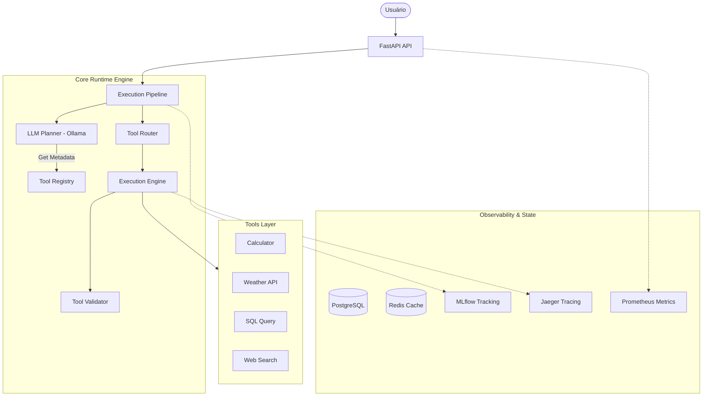

# LLM Tool Calling Runtime Engine 🛠️


> Uma engine de runtime robusta para execução e orquestração de chamadas de ferramentas (Tool Calling) por agentes de LLM, construída do zero.

Este projeto implementa a infraestrutura necessária para que um LLM não apenas "pense", mas "aja". Ele foca no planejamento estruturado, validação de argumentos, execução segura e observabilidade completa do ciclo de vida de uma ferramenta.

## 📚 Sumário

- [🧭 Visão Geral](#-visão-geral)
- [🏗️ Arquitetura](#️-arquitetura)
- [🔄 Fluxos do Projeto](#-fluxos-do-projeto)
- [🧰 Tecnologias e Serviços](#-tecnologias-e-serviços)
- [📁 Estrutura do Repositório](#-estrutura-do-repositório)
- [🚀 Instalação e Setup](#-instalação-e-setup)
- [🧪 Como Usar (Endpoints)](#-como-usar-endpoints)
- [📊 Observabilidade](#-observabilidade)
- [✅ Testes e Coverage](#-testes-e-coverage)

---

## 🧭 Visão Geral

O **LLM Tool Calling Runtime** resolve o desafio de integrar LLMs com ferramentas externas de forma confiável:
- **Structured Planning**: Usa o Ollama (Llama 3) para decidir quais ferramentas chamar e com quais argumentos.
- **Dynamic Registry**: Registro centralizado de ferramentas com metadados automáticos.
- **Safe Execution**: Isolamento de execução, timeouts e tratamento de erros.
- **Deep Observability**: Rastreia desde a intenção do LLM até o resultado da ferramenta.

---

## 🏗️ Arquitetura

O sistema segue um pipeline linear de processamento que garante validação em cada etapa.



---

## 🔄 Fluxos do Projeto

### 🧠 Fluxo de Execução (End-to-End)

1. **Recepção**: O usuário envia um prompt via `POST /chat/`.
2. **Planejamento (Planning)**: O `Planner` consulta o `Tool Registry` para obter as definições das ferramentas e pede ao Ollama para gerar um plano de execução JSON.
3. **Roteamento (Routing)**: O `Tool Router` recebe o plano e despacha as chamadas para as ferramentas corretas.
4. **Validação**: O `Tool Validator` verifica se os argumentos fornecidos pelo LLM batem com o schema Pydantic da ferramenta.
5. **Execução**: O `Execution Engine` roda a ferramenta (sync ou async), aplicando políticas de timeout e segurança.
6. **Resposta Final**: O pipeline consolida os resultados e o LLM gera uma resposta final baseada nos dados obtidos.

---

## 🧰 Tecnologias e Serviços

| Serviço | Tecnologia | Porta | Função |
|---|---|---|---|
| **API** | FastAPI | `8000` | Orquestração do pipeline e interface REST. |
| **LLM** | Ollama (Llama 3) | `11434` | Inteligência para planejamento e resposta. |
| **Database** | PostgreSQL | `5432` | Persistência de logs de execução e estado. |
| **Cache** | Redis | `6379` | Cache de resultados de ferramentas e locks. |
| **Tracking** | MLflow | `5000` | Rastreamento de prompts, planos e latência. |
| **Metrics** | Prometheus | `9090` | Coleta de métricas de performance. |
| **Dashboard** | Grafana | `3000` | Visualização de logs (Loki) e métricas. |
| **Tracing** | Jaeger | `16686` | Tracing distribuído das chamadas de ferramentas. |

---

## 📁 Estrutura do Repositório

```text
app/
├── api/            Endpoints FastAPI (v1)
├── core/           Configurações globais e segurança
├── execution/      Pipeline, Router e Engine de execução
├── planner/        Lógica de planejamento via LLM
├── runtime/        Registro e descoberta de ferramentas
├── schemas/        Modelos Pydantic para validação
├── telemetry/      Setup de Tracing e Logs
├── tools/          Implementação das ferramentas disponíveis
└── validation/     Validadores de schema e argumentos
monitoring/         Configurações de Prometheus, Grafana e Loki
tests/              Suíte de testes (Unitários e Integração)
docker/             Dockerfiles e ambientes
```

---

## 🚀 Instalação e Setup

### 📋 Pré-requisitos
- Docker e Docker Compose
- Python 3.12+ (para desenvolvimento local)

### 1. Preparar o Ambiente
```bash
cp .env.example .env
docker compose up -d
```

### 2. Configurar o Ollama
```bash
docker exec -it ollama ollama pull llama3
```

---

## 🧪 Como Usar (Endpoints)

### 💬 Executar um Prompt com Ferramentas
```bash
curl -X POST http://localhost:8000/api/v1/chat/ \
  -H "Content-Type: application/json" \
  -d '{
    "prompt": "Quanto é 1523 * 45 e como está o tempo em São Paulo?"
  }'
```

### 🛠️ Listar Ferramentas Disponíveis
```bash
curl http://localhost:8000/api/v1/tools/
```

### 🩺 Health Check
```bash
curl http://localhost:8000/health
```

---

## 📊 Observabilidade

A stack de observabilidade permite auditar cada decisão do agente:

- **MLflow**: Veja o JSON exato gerado pelo LLM no planejamento.
- **Jaeger**: Analise quanto tempo cada ferramenta levou para responder.
- **Grafana**: Dashboards consolidados de logs e métricas.

---

## ✅ Testes e Coverage

Para rodar os testes e garantir a integridade do sistema:

```bash
make test
```

Para ver o relatório de cobertura:
```bash
make coverage
```

---
